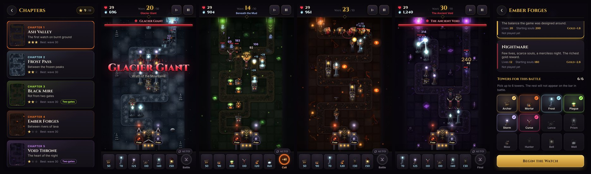

# Soulgate: Tower Defense

**Karanlık fantastik bir kule savunma oyunu.** Kuleni kur, geliştir, ustalaştır; kaleyi otuz dalga boyunca ayakta tut.
**A dark fantasy tower defense game.** Build, upgrade and master your towers; hold the castle through thirty waves.

- ▶ **Tarayıcıda oyna / Play in the browser:** https://a-sayan.github.io/soulgate/
- 📱 **Android (APK):** [Sürümler / Releases](https://github.com/A-Sayan/soulgate/releases/latest)
- 💬 **Geri bildirim / Feedback:** https://a-sayan.itch.io/soulgate-tower-defense

---

## Türkçe

- **5 bölüm**: Kül Vadisi, Ayaz Geçidi, Kara Bataklık, Kor Ocakları, Boşluk Tahtı. Her biri 30 dalga, kendi haritası, müziği ve havasıyla. İkisinde düşmanlar iki kapıdan gelir.
- **12 kule**, her savaştan önce 6'sını seçersin. **9 beceri**, **39 düşman** (11 boss), **5 kale geliştirmesi**.
- Bölümler sırayla açılır; kazandığın her zorluk bir yıldız (toplam 15).
- Her bölümün asıl tehdidi (ağır zırh, uçanlar, yenilenme…) bölüm seçerken görünür. İlk savaşta kısa bir öğretici yol gösterir; ayarlardan kapatılabilir.
- Türkçe ve İngilizce. İnternetsiz çalışır; telefonda "Ana ekrana ekle" ile uygulama gibi kurulabilir.
- Telefonda, tablette ve bilgisayarda oynanır; bilgisayarda tam ekran, geniş ekran düzeni. Fare ve klavye: 1–6 kule, Boşluk dalga, F hız, Q / E yetenekler, U yükselt, X sat, sağ tık vazgeç.

### Android'e kurulum

1. [Sürümler](https://github.com/A-Sayan/soulgate/releases/latest) sayfasından `Soulgate-x.y.z.apk` dosyasını indir.
2. Dosyayı aç. Telefon "bilinmeyen kaynaklar" için izin isterse bu seferlik izin ver.
3. Yeni sürümler eskisinin üstüne kurulur; ilerlemen korunur.

## English

- **5 chapters**, 30 waves each, with their own map, music and atmosphere; two of them have two gates.
- **12 towers** (pick 6 before each battle), **9 skills**, **39 enemies** (11 bosses), **5 castle upgrades**.
- Chapters unlock in order; every difficulty you win is a star (15 in total).
- Each chapter shows its main threat (heavy armor, flyers, regeneration…) when you pick it. A short tutorial guides your first battle; it can be turned off in Settings.
- Turkish and English. Works offline; can be installed from the browser with "Add to Home screen".
- Plays on phones, tablets and computers; full-screen wide layout on computers. Mouse and keyboard: 1–6 towers, Space wave, F speed, Q / E skills, U upgrade, X sell, right-click to cancel.

### Installing on Android

1. Download `Soulgate-x.y.z.apk` from [Releases](https://github.com/A-Sayan/soulgate/releases/latest).
2. Open it. If your phone asks about installing from unknown sources, allow it for this install.
3. New versions install over the old one; your progress is kept.

---

## Yapımcılar / Credits

- **Yayıncı / Publisher:** Sayk Studio
- **Geliştirici / Developer:** A. Sayan
- **Yardımcı geliştirici / Assistant developer:** S. Soytürk

## Lisans / License

© 2026 Sayk Studio (A. Sayan). **Tüm hakları saklıdır / All rights reserved.**
Kodun bu depoda görünmesi kopyalama, değiştirme, dağıtma ya da satma izni vermez. Ayrıntılar: [LICENSE](LICENSE).
The source being visible here grants no permission to copy, modify, distribute or sell it. See [LICENSE](LICENSE).

Yazı tipleri / Fonts: Cinzel ve Inter, SIL Open Font License 1.1 ([fonts/](fonts/)).

---

Geliştirme notları / Development notes

- Oyun saf JavaScript (ES modülleri) ve canvas; derleme adımı yok. `index.html` bir web sunucusundan açılır.
- `android/` WebView kabuğudur; oyun dosyaları derlemede `assets/www` içine kopyalanır. Sürüm numarası `js/config.js` içindeki `GAME.version`'dan okunur.
- `v1.2.0` gibi bir etiket gönderilince `.github/workflows/release.yml` imzalı APK'yı ve itch.io web paketini derleyip Sürümler'e koyar. İmza anahtarı depoda değil, tek bir Actions gizli değerindedir: `SOULGATE_SIGNING` (`parola:base64-anahtar-deposu`).
- `main` dalına gönderilen oyun dosyaları `.github/workflows/pages.yml` ile GitHub Pages'e yayımlanır.

